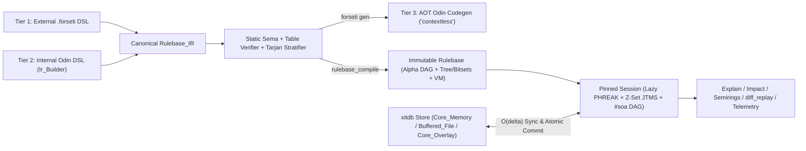

# Forseti

[](https://github.com/boxxxie/forseti/actions/workflows/ci.yml)
[](CHANGELOG.md)
[](https://odin-lang.org/)
[](LICENSE)
[](docs/benchmarks.md)
[](docs/benchmarks.md#32-decision-tables--hardware-counters-decision_tables)
[](forseti/phreak_eval.odin)
[](docs/dsl-reference.md)
[](https://github.com/boxxxie/odin-xitdb)
[](docs/benchmarks.md#33-beta-joins--zero_alloc-hot-match-beta_joins)
[](specs/)

**A pure-Odin, data-oriented rules engine, verified DMN decision-table compiler, and stratified Datalog runtime with verifiable causal audit trails backed by [`xitdb`](https://github.com/boxxxie/odin-xitdb).**

Forseti replaces tangled `if`/`else` business logic, unverified spreadsheet rules, and ad-hoc audit logging with **one canonical intermediate representation (`Rulebase_IR`)** shared across an external `.forseti` DSL, a typed internal Odin DSL, and zero-allocation AOT Odin codegen. Built primarily for **Master Data Management (MDM), policy governance, and high-throughput incremental reasoning**, it compiles static decision-table soundness proofs alongside an incremental `O(active)` PHREAK matcher, DBSP-style Z-set truth maintenance, and atomic copy-on-write provenance persistence.

---

## Why Forseti?

- **Three Authoring Tiers over One Canonical IR:** Author policies in the **External `.forseti` DSL** (zero-copy lexer, hot-reload, compiler diagnostics), build rules programmatically with the **Internal Odin DSL** (`Ir_Builder`), or freeze hot tables into `"contextless"` **AOT Odin procedures** (`forseti gen`).
- **Compiler-Verified DMN Decision Tables (`Tablex++` / `ZEN`):** Supports `First`, `Unique`, `Any`, `Priority`, `Collect` (`_Sum`, `_Min`, `_Max`, `_Count`), `Merge`, and `Reverse_Merge`. Static domain partitioning catches overlaps, dead/shadowed rules, unsatisfiable predicates, and coverage gaps with **concrete counterexample witnesses** before deployment.
- **Lazy PHREAK Matcher & `1,000,000`-Rule Scale:** Shared alpha DAG, `u64` segment bitmasks, Left/Right unlinking, 32-bit `#must_tail` guard VM, and lazy per-session memory allocation keep `session_init` at `O(1)` (`19.48 us`) even across `1,000,000` rules (`~556 B/rule`).
- **Z-Set JTMS + Stratified Semi-Naive Datalog:** Logical `assert` derivations retract automatically in cascade when premises vanish, while `assert! ... unconditional` preserves permanent audit entries. Supports `not`/`exists`, retractable accumulators (`count`, `sum`, `min`, `max`, `avg`, `distinct`), and Tarjan SCC recursion over cyclic hierarchies.
- **Universal `xitdb` Substrate & Causal Provenance:** Syncs incrementally from `Core_Memory` (`~3M+ items/s`), durable `Core_Buffered_File`, or zero-copy `Core_Overlay` counterfactual forks (`diff_replay`). Records `#soa` derivation DAGs, commits `.decisions` + `.idx.*` + `.__tx` atomically, and answers `explain`, `impact`, and algebraic semiring (`Boolean`, `Why`, `How`, `Viterbi`) queries.
- **Built-In Telemetry & Longitudinal Benchmarking:** Captures phase timings, rule/memory counters, and memory watermarks (`JSONL` / Chrome Trace) and ships [`hugi`](https://github.com/boxxxie/hugi) + [`obench`](https://github.com/zeybek/obench) benchmarks spanning `10` to `1,000,000` rules.

---

## Architecture Overview



---

## What the DSLs & Code Look Like

### 1. External `.forseti` DSL (Tier 1)

Declare typed schemas, `xitdb` path bindings (`source` / `derived`), statically verified DMN decision tables with column `cost` ordering, phased rules with negation/overrides/async effects, and parameterized queries in one readable policy file:

```forseti
module customer_mdm version "1.0"

schema RawAccount {
  id: string,
  domain: string,
  employees: i64,
  active: bool,
  risk_score: f64
}
schema SuppressedDomain { domain: string }
schema GoldenAccount {
  id: string,
  domain: string,
  tier: string
}
schema AuditLog { id: string, tier: string }

source RawAccount : RawAccount at .accounts.raw[?id]
source Suppressed : SuppressedDomain at .accounts.suppressed[?id]
derived GoldenAccount : GoldenAccount at .accounts.golden[?id]
derived AuditLog : AuditLog at .accounts.audit[?id]

// Lazy cost-ordered tree skips `risk_score` (cost 100) unless needed!
table survivorship_gate version "1.0" hit First verify(complete, no_dead_rules) {
  inputs {
    employees:  i64  cost 1,
    active:     bool cost 1,
    risk_score: f64  cost 100
  }
  outputs {
    tier:   string,
    action: string
  }
  rows {
    r_enterprise: >= 200 | true | < 0.70 || "enterprise" | "auto_merge";
    r_growth:     >= 50  | true | -      || "growth"     | "auto_merge";
    r_review:     -      | -    | -      || "standard"   | "steward_review";
  }
}

rule promote_account phase "survive" salience 50 {
  when {
    ?_raw := RawAccount(id: ?aid, domain: ?dom, employees: ?emp, active: ?ok, risk_score: ?risk)
    ?gate := decide survivorship_gate(employees: ?emp, active: ?ok, risk_score: ?risk)
    not Suppressed(domain: ?dom)
    where ?gate.action == "auto_merge"
  }
  then {
    assert GoldenAccount(id: ?aid, domain: ?dom, tier: ?gate.tier)
    assert! AuditLog(id: ?aid, tier: ?gate.tier) unconditional
  }
  effect "notify_steward" { account_id: ?aid, tier: ?gate.tier }
}

query golden_by_tier(tier: string) {
  GoldenAccount(id: ?aid, domain: ?dom, tier: ?tier)
}
```

> [!TIP]
> `assert` creates a logically justified fact maintained by Z-set JTMS (automatically retracted if `RawAccount` leaves or `Suppressed` arrives), whereas `assert! ... unconditional` writes an immutable audit record that survives upstream retractions.

#### Compile-Time Safety & Counterexample Witnesses

Running `forseti check` or `forseti verify-tables` catches overlaps, coverage gaps, dead rows, unbound variables, and unstratified negation cycles with exact `file:line:col` spans before a rule ever runs:

```text
policy.forseti:18:5: error[E3001]: overlapping rules "r_gold" and "r_platinum" in table "tier_gate" at witness {score=90, active=true}
  hint: make rule predicates disjoint or use First/Priority hit policy
policy.forseti:31:3: error[E4001]: unstratified negation cycle detected: A -(!)-> B -> A
  hint: separate base derivation from negated/aggregated stratum
```

---

### 2. Internal Odin DSL (Tier 2 — `Ir_Builder`)

Build the exact same canonical `Rulebase_IR` programmatically inside Odin without parsing `.forseti` text:

```odin
b: forseti.Ir_Builder
if forseti.ir_builder_init(&b, "mdm_internal", "1.0") != nil {
	return
}
defer forseti.ir_builder_destroy(&b)

_ = forseti.ir_schema(&b, "Account", {
	forseti.field("id", .String),
	forseti.field("employees", .I64),
	forseti.field("active", .Bool),
})
_ = forseti.ir_schema(&b, "Golden", {
	forseti.field("id", .String),
	forseti.field("tier", .String),
})
_ = forseti.ir_source(&b, "RawAcct", "Account", ".acct.raw[?id]")
_ = forseti.ir_derived(&b, "GoldenAcct", "Golden", ".acct.golden[?id]")

_ = forseti.ir_table(&b, forseti.Table_Spec{
	name       = "tier_table",
	version    = "1.0",
	hit_policy = .First,
	inputs     = {
		{name = "employees", type = .I64, cost = 1},
		{name = "active", type = .Bool, cost = 1},
	},
	outputs = {{name = "tier", type = .String}},
	rows = {
		{id = "r_ent", cells = {forseti.cond(.Gte, i64(200)), forseti.lit(true)}, outputs = {forseti.lit("enterprise")}},
		{id = "r_smb", cells = {forseti.wildcard(), forseti.wildcard()}, outputs = {forseti.lit("smb")}},
	},
})

_ = forseti.ir_rule(&b, forseti.Rule_Spec{
	name     = "classify_acct",
	phase    = "survive",
	salience = 50,
	when_clauses = {
		forseti.pat("?_r", "RawAcct", {
			forseti.field_bind("id", forseti.vref("?id")),
			forseti.field_bind("employees", forseti.vref("?emp")),
			forseti.field_bind("active", forseti.vref("?act")),
		}),
		forseti.decide_clause("?g", "tier_table", {
			forseti.field_bind("employees", forseti.vref("?emp")),
			forseti.field_bind("active", forseti.vref("?act")),
		}),
	},
	then_actions = {
		forseti.assert_fact("GoldenAcct", {
			forseti.field_bind("id", forseti.vref("?id")),
			forseti.field_bind("tier", forseti.fget("?g", "tier")),
		}),
	},
})

diags: forseti.Diagnostic_List
_ = forseti.diag_list_init(&diags)
defer forseti.diag_list_destroy(&diags)

ir, _ := forseti.ir_builder_build(&b, &diags)
defer forseti.ir_destroy(&ir)
```

---

### 3. AOT Odin Codegen (Tier 3 — `forseti gen`)

Freeze any verified decision table into a `"contextless"`, zero-allocation native Odin module:

```odin
// Code generated by forseti. DO NOT EDIT.
package generated_tables

Tier_Table_Input :: struct {
	employees: i64,
	active:    bool,
}

Tier_Table_Output :: struct {
	matched:       bool,
	row_id:        string,
	matched_count: u32,
	tier:          string,
	tier_set:      bool,
}

decide_tier_table :: proc "contextless" (in_val: Tier_Table_Input) -> Tier_Table_Output {
	if in_val.employees >= 200 && in_val.active == true {
		return Tier_Table_Output{
			matched = true,
			row_id = tier_table_row_ids[0],
			matched_count = 1,
			tier = "enterprise",
			tier_set = true,
		}
	}
	if true {
		return Tier_Table_Output{
			matched = true,
			row_id = tier_table_row_ids[1],
			matched_count = 1,
			tier = "smb",
			tier_set = true,
		}
	}
	return {}
}
```

---

### 4. Embedding in Odin (`Session` + `xitdb` + Causal `explain` & `diff_replay`)

Compile a `Rulebase` once (immutable and shareable), attach a `Session` to an `xitdb` v2 file store with incremental delta syncing, inspect causal proof trees, and evaluate policy changes in a zero-copy `Core_Overlay` fork:

```odin
diags: forseti.Diagnostic_List
assert(forseti.diag_list_init(&diags) == nil)
defer forseti.diag_list_destroy(&diags)

ir, c_err := forseti.compile_source(policy_src, "customer_mdm.forseti", &diags)
assert(c_err == nil && diags.error_count == 0)
defer forseti.ir_destroy(&ir)

rb, rb_err := forseti.rulebase_compile(&ir)
assert(rb_err == .None)
defer forseti.rulebase_destroy(&rb)

// Pinned Session: heap-allocate via new(...) or keep in-place; never copy by value.
sess := new(forseti.Session)
assert(forseti.session_init(sess, &rb) == .None)
defer {
	forseti.session_destroy(sess)
	free(sess)
}

bridge: forseti.Store_Bridge
assert(forseti.store_bridge_open_file(&bridge, "mdm.xit") == nil)
defer forseti.store_bridge_destroy(&bridge)

syncer: forseti.Delta_Syncer
assert(forseti.delta_syncer_init(&syncer) == nil)
defer forseti.delta_syncer_destroy(&syncer)
_ = forseti.delta_syncer_watch(&syncer, ".accounts.raw")

// Incremental O(delta) sync -> PHREAK match -> Z-set JTMS -> atomic .decisions / .__tx commit
fired, s_err := forseti.session_sync_and_fire(sess, &bridge, &syncer, commit_derived = true)
assert(s_err == nil)

// Inspect causal proof tree, algebraic How-provenance, or counterfactual policy diff
tree := forseti.explain(sess, derived_fid)
defer forseti.explain_tree_destroy(&tree)

how := forseti.evaluate_semiring(sess, derived_fid, .How)
defer forseti.semiring_result_destroy(&how)

diff_rep, d_err := forseti.session_diff_replay(sess, &bridge, &candidate_rb, {".accounts.raw"})
assert(d_err == nil)
defer forseti.diff_replay_report_destroy(&diff_rep)
```

---

## Performance Highlights (`10` to `1,000,000` Rules)

Measured on Linux `x86_64` (`AMD Ryzen 7 7735U`, `-o:speed -microarch:native`, `e9cd4fc`) using [`hugi`](https://github.com/boxxxie/hugi) + [`obench`](https://github.com/zeybek/obench) in [`benchmarks/history.hugidb`](benchmarks/history.hugidb). See the full methodology, hardware PMU counters, and complexity curves in [`docs/benchmarks.md`](docs/benchmarks.md).

| Workload | Scale | Median `p50` | Heap Allocs / Op | Key Invariant |
| :--- | :---: | :---: | :---: | :--- |
| **`aot_native_fast_path`** (Tier 3) | `10,000` rows | **`716.48 ps`** | **`0`** | `proc "contextless"` (`2.0` cycles, IPC `4.08`) |
| **`lazy_cost_skip`** (`First` cost tree) | `10,000` rows | **`28.80 ns`** | **`0`** | `O(1)` eval; expensive columns skipped |
| **`bitset_collect_sum`** (`Collect_Sum`) | `1,000` rows | **`83.00 ns`** | **`0`** | Branchless ternary `u64` bitset matrix |
| **`lazy_session_init`** | `1,000,000` rules | **`19.48 us`** | `54 / 80.93 KiB` | **`O(1)`** init regardless of rule count |
| **`sparse_alpha_match`** | `1,000,000` rules | **`2.27 us`** | `8.1 / 2.30 KiB` | Shared alpha DAG + lazy segment linking |
| **`compile_rules`** | `1,000,000` rules | **`1.772 s`** | `15 / 104 MiB` | `~556 B/rule` arena footprint (`556 MB` total) |
| **`phreak_hot_match_zero_alloc`** (`.Fast`) | `1,000` bg facts | **`1.32 ms`** | **`0`** | Verified `@zero_alloc` PHREAK + JTMS toggle |
| **`diff_10_of_10k_safe_v2`** (`xitdb`) | `10,000` records | **`3.56 us`** | **`0`** | Slot-skipping HAMT diff (`2.81 M items/s`) |

---

## CLI Quick Start (`cmd/forseti`)

```bash
COLS="-collection:xitdb=../xitdb/xitdb -collection:hugi=../hugi/hugi -collection:obench=../hugi/deps/obench/obench"

# 1. Compile, lint, and verify decision tables statically
odin run cmd/forseti $COLS -- check policy.forseti --warnings-as-errors
odin run cmd/forseti $COLS -- verify-tables policy.forseti

# 2. Execute against JSON facts or a persisted xitdb v2 store
odin run cmd/forseti $COLS -- run --facts facts.json --store mdm.xit --format=json policy.forseti

# 3. Audit causal lineage, rule blast radius, and counterfactual policy changes
odin run cmd/forseti $COLS -- explain --facts facts.json --binding CanonOrg policy.forseti
odin run cmd/forseti $COLS -- impact --facts facts.json --rule canonicalize --format=json policy.forseti
odin run cmd/forseti $COLS -- diff-replay --candidate v2.forseti --facts facts.json --format=json v1.forseti

# 4. Capture telemetry, export visual graphs, or emit AOT Odin tables
odin run cmd/forseti $COLS -- telemetry --facts facts.json --format=chrome-trace --out trace.json policy.forseti
odin run cmd/forseti $COLS -- export-mermaid --graph=rulebase policy.forseti
odin run cmd/forseti $COLS -- gen --package generated_tables --out generated_tables.odin policy.forseti
```

<details>
<summary>All 12 CLI Subcommands</summary>

| Command | Purpose |
| :--- | :--- |
| `check` | Parse, typecheck, lint (`E1xxx–E4xxx`, `W2xxx–W3xxx`), and stratify |
| `verify-tables` | Static gap/overlap/dead-rule proofs across all DMN tables |
| `gen` | Emit `"contextless"` AOT Odin evaluators |
| `ast` | Print deterministic S-expression AST |
| `ir` | Print lowered canonical `Rulebase_IR` summary |
| `run` | Execute policy against `--facts` and/or `--store` |
| `explain` | Reconstruct causal proof trees for derived facts |
| `impact` | Report direct & transitive downstream impact of `--rule` |
| `diff-replay` | Compare baseline vs `--candidate` over a zero-copy `Core_Overlay` |
| `telemetry` | Export phase spans, counters, and watermarks (`jsonl` / `chrome-trace`) |
| `export-dot` | Export rulebase or derivation DAG as Graphviz DOT |
| `export-mermaid` | Export rulebase or derivation DAG as Mermaid flowchart |

</details>

---

## Installation, Setup & Verification

Forseti has **zero external C dependencies** (`base:*` and `core:*` plus sibling Odin collections in [`ols.json`](ols.json)).

### 1. Clone Sibling Collections

```bash
mkdir -p odin-workspace && cd odin-workspace
git clone https://github.com/boxxxie/forseti.git
git clone https://github.com/boxxxie/odin-xitdb.git xitdb
git clone https://github.com/boxxxie/hugi.git
git -C hugi submodule update --init deps/obench
cd forseti
```

### 2. Static Checks, Leak-Checked Tests & Benchmarks

Every test target runs under strict compiler vetting and `-define:ODIN_TEST_FAIL_ON_BAD_MEMORY=true`:

```bash
COLS="-collection:xitdb=../xitdb/xitdb -collection:hugi=../hugi/hugi -collection:obench=../hugi/deps/obench/obench"
VET="-vet -vet-tabs -strict-style -disallow-do -warnings-as-errors"

# Strict static checks across library, CLI, tests, and specs
odin check forseti -no-entry-point $COLS $VET
odin check cmd/forseti $COLS $VET

# Full leak-checked unit/property/doc/example tests & 4-layer ATDD specs
odin test tests -all-packages $COLS $VET -define:ODIN_TEST_FAIL_ON_BAD_MEMORY=true
odin test specs -all-packages $COLS $VET -define:ODIN_TEST_FAIL_ON_BAD_MEMORY=true

# AddressSanitizer differential / oracle fuzz checks
odin test tests -sanitize:address -collection:xitdb=../xitdb/xitdb -define:ODIN_TEST_FAIL_ON_BAD_MEMORY=true

# Package docs verification & longitudinal benchmarks
odin doc forseti -collection:xitdb=../xitdb/xitdb > /dev/null
hugi run
```

---

## Runnable Examples (`examples/`)

Every example compiles cleanly under strict `-vet -strict-style -warnings-as-errors` and is verified end-to-end with Odin's `mem.Tracking_Allocator` by [`tests/test_examples_verify.odin`](tests/test_examples_verify.odin):

| Example | What It Demonstrates | Run Command |
| :--- | :--- | :--- |
| [`01_decision_tables`](examples/01_decision_tables/main.odin) | `First` lazy cost-skipping, `Collect_Sum`, `Merge`, and Tier 3 AOT codegen | `odin run examples/01_decision_tables -collection:xitdb=../xitdb/xitdb` |
| [`02_mdm_xitdb_pipeline`](examples/02_mdm_xitdb_pipeline/main.odin) | `xitdb` v2 disk store, `Delta_Syncer`, atomic `.decisions` & `.__tx` commit | `odin run examples/02_mdm_xitdb_pipeline -collection:xitdb=../xitdb/xitdb` |
| [`03_jtms_steward_overrides`](examples/03_jtms_steward_overrides/main.odin) | Diamond support survival, cascading retractions, and `assert!` audit logs | `odin run examples/03_jtms_steward_overrides -collection:xitdb=../xitdb/xitdb` |
| [`04_cyclic_hierarchies`](examples/04_cyclic_hierarchies/main.odin) | Tarjan-stratified cyclic recursion, `explain`, and cycle-break retraction | `odin run examples/04_cyclic_hierarchies -collection:xitdb=../xitdb/xitdb` |
| [`05_accumulators_and_effects`](examples/05_accumulators_and_effects/main.odin) | Tied-minimum retractable accumulators & 3-phase `core:thread` async effects | `odin run examples/05_accumulators_and_effects -collection:xitdb=../xitdb/xitdb` |
| [`06_internal_odin_dsl_and_aot`](examples/06_internal_odin_dsl_and_aot/main.odin) | Tier 2 `Ir_Builder` internal DSL & Tier 3 AOT Odin output | `odin run examples/06_internal_odin_dsl_and_aot -collection:xitdb=../xitdb/xitdb` |
| [`07_telemetry_and_diff_replay`](examples/07_telemetry_and_diff_replay/main.odin) | Telemetry `JSONL` / Chrome Trace, `Core_Overlay` `diff_replay`, Mermaid export | `odin run examples/07_telemetry_and_diff_replay -collection:xitdb=../xitdb/xitdb` |
| [`08_sleipnir_actor_runtime`](examples/08_sleipnir_actor_runtime/main.odin) | Sleipnir `Session_Actor`, `Xitdb_Commit_Actor`, `Partitioned_Supervisor`, hot-reload & parallel `diff_replay` | `odin run examples/08_sleipnir_actor_runtime -collection:xitdb=../xitdb/xitdb -collection:actor=../sleipnir/actor` |

---

## Documentation & Agent Guides

| Guide | Audience | Contents |
| :--- | :--- | :--- |
| [**Documentation Hub (`docs/README.md`)**](docs/README.md) | Everyone | Architecture diagrams, conceptual mental models, and reading paths |
| [**Odin Embedding Guide (`docs/odin-api.md`)**](docs/odin-api.md) | Odin Developers | Lifetimes, `Session`, `Delta_Syncer`, `explain`/semirings, async effects, AOT |
| [**DSL & CLI Reference (`docs/dsl-reference.md`)**](docs/dsl-reference.md) | Policy & Tool Authors | Full EBNF grammar, hit policies, CLI flags, verified `E*`/`W*` error catalog |
| [**Benchmarks & Scaling (`docs/benchmarks.md`)**](docs/benchmarks.md) | Perf Engineers | `10`–`1M` rule scaling, hardware PMU counters, `@zero_alloc` hot-path audit |
| [**Agent Usage Rules (`usage-rules.md`)**](usage-rules.md) | AI Coding Agents | Prescriptive decision trees, canonical recipes, and top 12 pitfalls |
| [**Repository Guide (`AGENTS.md`)**](AGENTS.md) | Contributors & Agents | Package invariants, 4-layer ATDD rules, and canonical build/test gates |

---

## Repository Layout

```text
.
├── forseti/        # Core library: lexer, parser, IR, sema, DMN verifier/AOT, xitdb bridge, PHREAK, JTMS, Datalog, telemetry
├── actors/         # Optional Sleipnir multi-threaded runtime (Session_Actor, Xitdb_Commit_Actor, Tenant_Rule_Runtime, Effect_Dispatcher)
├── cmd/forseti/    # Operational CLI (check, verify-tables, gen, ast, ir, run, explain, impact, diff-replay, telemetry, export-*)
├── specs/          # Black-box 4-layer ATDD executable specifications (package forseti_specs)
├── specs_actors/   # Black-box 4-layer ATDD specs for Sleipnir actor runtime (package forseti_actors_specs)
├── tests/          # Pattern E unit tests, Pattern D t.seed property/oracle tests, doc-snippet & example verifiers
├── examples/       # 8 standalone leak-checked runnable examples (01_decision_tables .. 08_sleipnir_actor_runtime)
├── benchmarks/     # Longitudinal hugi + obench scaling suite (10 to 1,000,000 rules)
├── docs/           # Documentation hub, Odin embedding guide, DSL/CLI reference, xitdb modes & benchmark reports
├── conductor/      # Conductor specifications, architecture guidelines, and sequenced implementation tracks
└── scripts/        # Optional upstream reference repo fetcher (reference/README.md)
```

---

## Roadmap

Development is tracked sequentially in [`conductor/tracks.md`](conductor/tracks.md):

- [x] **Tracks 1–7:** Core `.forseti` & Internal DSL, `Rulebase_IR`, Verified DMN Tables & AOT Codegen, `xitdb` Substrate & `Core_Overlay`, Lazy PHREAK + `#must_tail` Guard VM, Z-Set JTMS / Stratified Datalog / Semirings / Async Effects, `1M`-Rule Benchmarks, and Full CLI + Verified Examples.
- [x] **Track 8:** Cross-OS CI Matrix (`ubuntu-latest`, `macos-latest`, `windows-latest`), Actions/Repo Hygiene & `v0.1.0` Release Prep ([spec](conductor/tracks/cross_os_ci_hygiene_and_v0_1_0_release_20261122/spec.md)).
- [~] **Track 9:** [**Sleipnir (`package actor`)**](https://github.com/boxxxie/sleipnir) Multi-Threaded Session Runtime — pinned `Session_Actor`s, `Chain=K` batching, single-writer `Xitdb_Commit_Actor`, OTP `Partitioned_Supervisor` tenant isolation, actor-native 3-phase async effects, parallel `Core_Overlay` `diff_replay`, and ref-counted hot-reload ([spec](conductor/tracks/sleipnir_actor_multithreaded_runtime_20261122/spec.md)).
- [ ] **Track 10:** `.forseti` Language Server (LSP), Canonical Table-Aligning Formatter (`forseti fmt`) & TextMate / Tree-sitter Grammars ([spec](conductor/tracks/forseti_lsp_formatter_and_editor_tooling_20261122/spec.md)).
- [ ] **Track 11:** Stable C99 ABI (`libforseti` + `forseti.h`), Typed Odin Struct Embeds & DSL v1.1 (`import` + pure built-ins) ([spec](conductor/tracks/c_abi_external_integration_and_dsl_v1_1_20261122/spec.md)).

---

## License

Distributed under the **MIT License**. See [`LICENSE`](LICENSE) for full details.
