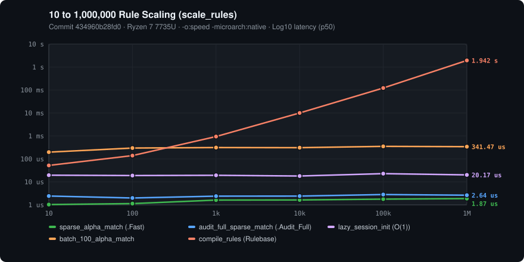
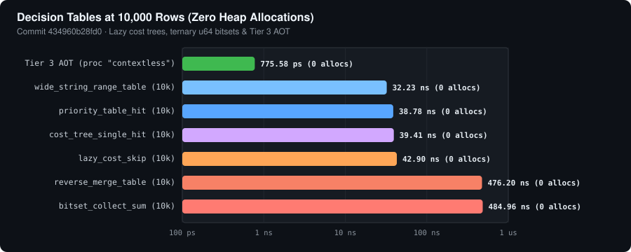
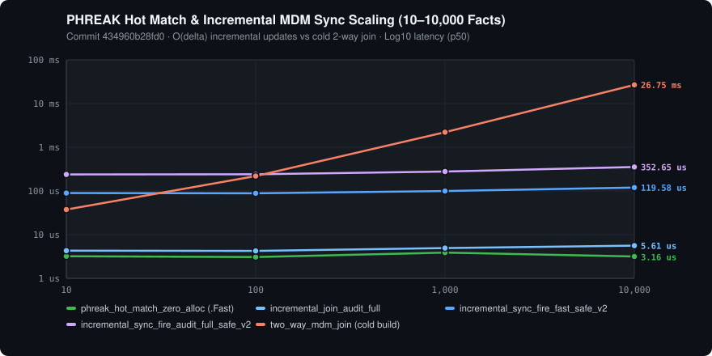
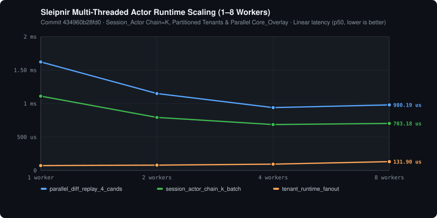
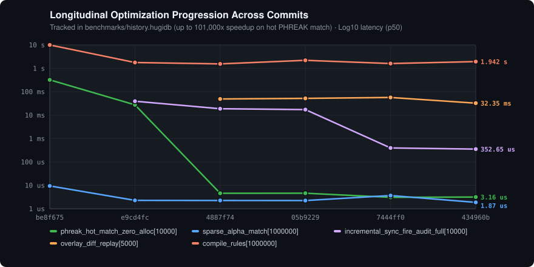

[Root README](../README.md) · [Docs Hub](../docs/README.md) · [Benchmarks Analysis](../docs/benchmarks.md) · **Suite Renders**

# Forseti Benchmarks & Visual Renders

This directory contains Forseti's longitudinal [`hugi`](https://github.com/boxxxie/hugi) + [`obench`](https://github.com/zeybek/obench) benchmark suite (`253` benchmarks across `14` groups, `11,989` samples at commit `434960b28fd0` in [`history.hugidb`](history.hugidb)), visual SVG charts rendered via [`runa`](https://github.com/boxxxie/runa) under [`renders/`](renders/), and a `--profile-1m` telemetry sweep.

> For architectural deep dives, hardware PMU counters, and Phase 2 optimization notes, see [`docs/benchmarks.md`](../docs/benchmarks.md).

---

## Visual Renders (`v0.1.0` Snapshot)

### 1. `10` to `1,000,000` Rule Scaling

Lazy `session_init` holds flat at **`20.17 us` (`O(1)`)** and `sparse_alpha_match` stays at **`1.87 us`** (`2.64 us` `.Audit_Full`) even when `1,000,000` rules are compiled into the `Rulebase`:



### 2. Decision Tables at `10,000` Rows (`0` Heap Allocations)

Tier 3 `contextless` AOT tables execute in **`775.58 ps`**, while runtime cost-ordered decision trees (`38.78–42.90 ns`) and `u64` ternary bitset matrices (`476.20–484.96 ns`) run with **`0` heap allocations**:



### 3. PHREAK Hot Match & Incremental MDM Sync (`10`–`10,000` Facts)

`phreak_hot_match_zero_alloc` holds flat at **`3.16 us` (`O(1)`, `0` allocs)** across `10`–`10,000` background facts, and `O(delta)` `xitdb` sync+fire executes in **`119.58 us` (`.Fast`) / `352.65 us` (`.Audit_Full`)**:



### 4. Sleipnir Multi-Threaded Actor Runtime (`1`–`8` Workers)

`Parallel_Diff_Replay` over `4` candidate rulebases scales from `1.62 ms` (`1w`) down to **`939.51 us` (`4w`)**, and `Session_Actor` `Chain=K` batching drops from `1.11 ms` to **`686.03 us` (`4w`)**:



### 5. Longitudinal Optimization Progression

Tracked in [`history.hugidb`](history.hugidb) across commits `be8f675` through `434960b` (`~101,000x` speedup on `phreak_hot_match_zero_alloc[10000]` and `111x` on `incremental_sync_fire_audit_full_safe_v2[10000]` since `e9cd4fc`):



---

## Reproducing & Regenerating Renders

```bash
# 1. Run smoke checks (@zero_alloc verification across non-1M groups)
hugi run --test --groups decision_tables,xitdb_modes,beta_joins,jtms_churn,recursive_strata,mdm_e2e

# 2. Run the full suite and record into benchmarks/history.hugidb
hugi run --runs 1 --warmup 1

# 3. Regenerate SVG charts in benchmarks/renders/ and tables below using runa AOT templates
odin run benchmarks/render -collection:runa=../runa

# 4. Run the standalone 10..1,000,000 rule telemetry sweep
XITDB="-collection:xitdb=../xitdb/xitdb"
ACTOR="-collection:actor=../sleipnir/actor"
HUGI="-collection:hugi=../hugi/hugi -collection:obench=../hugi/deps/obench/obench"
odin build benchmarks -out:/tmp/forseti_bench -o:speed -microarch:native $XITDB $ACTOR $HUGI
/tmp/forseti_bench --profile-1m
```

---

## Full Benchmark Results (`253` Benchmarks at `434960b28fd0`)

<!-- BEGIN_BENCHMARK_TABLE -->
### Decision Tables (`First`, `Unique`, `Priority`, `Collect_Sum`, `Merge`, AOT) (`36` benchmarks)

Cost-ordered lazy decision trees, ternary `u64` bitset matrices, and `"contextless"` AOT Odin codegen (all `0` heap allocs).

| Benchmark | Median (`p50`) | `P95` | Ops/s | `CV%` | Allocs / op |
| :--- | ---: | ---: | ---: | ---: | ---: |
| `cost_tree_single_hit[10]` | **43.12 ns** | 47.74 ns | 23.19M/s | 5.6% | **0** |
| `lazy_cost_skip[10]` | **45.68 ns** | 53.23 ns | 21.89M/s | 6.5% | **0** |
| `bitset_collect_sum[10]` | **68.25 ns** | 70.22 ns | 14.65M/s | 1.9% | **0** |
| `aot_native_fast_path[10]` | **783.35 ps** | 803.17 ps | 1.28B/s | 1.3% | **0** |
| `unique_table_hit[10]` | **40.99 ns** | 44.32 ns | 24.40M/s | 3.6% | **0** |
| `priority_table_hit[10]` | **42.18 ns** | 45.69 ns | 23.71M/s | 8.2% | **0** |
| `merge_table_outputs[10]` | **62.41 ns** | 64.30 ns | 16.02M/s | 4.5% | **0** |
| `reverse_merge_table_outputs[10]` | **62.26 ns** | 64.70 ns | 16.06M/s | 2.6% | **0** |
| `wide_string_range_table[10]` | **40.55 ns** | 42.42 ns | 24.66M/s | 2.2% | **0** |
| `cost_tree_single_hit[100]` | **40.57 ns** | 41.65 ns | 24.65M/s | 1.7% | **0** |
| `lazy_cost_skip[100]` | **44.45 ns** | 49.39 ns | 22.50M/s | 12.3% | **0** |
| `bitset_collect_sum[100]` | **69.31 ns** | 71.37 ns | 14.43M/s | 1.9% | **0** |
| `aot_native_fast_path[100]` | **775.34 ps** | 781.71 ps | 1.29B/s | 1.6% | **0** |
| `unique_table_hit[100]` | **40.31 ns** | 41.25 ns | 24.81M/s | 2.4% | **0** |
| `priority_table_hit[100]` | **41.03 ns** | 43.58 ns | 24.37M/s | 7.7% | **0** |
| `merge_table_outputs[100]` | **63.18 ns** | 65.03 ns | 15.83M/s | 1.4% | **0** |
| `reverse_merge_table_outputs[100]` | **63.59 ns** | 66.17 ns | 15.73M/s | 2.5% | **0** |
| `wide_string_range_table[100]` | **33.47 ns** | 35.24 ns | 29.88M/s | 6.4% | **0** |
| `cost_tree_single_hit[1000]` | **39.97 ns** | 40.76 ns | 25.02M/s | 1.5% | **0** |
| `lazy_cost_skip[1000]` | **42.70 ns** | 43.63 ns | 23.42M/s | 2.4% | **0** |
| `bitset_collect_sum[1000]` | **86.57 ns** | 89.97 ns | 11.55M/s | 1.9% | **0** |
| `aot_native_fast_path[1000]` | **761.55 ps** | 770.22 ps | 1.31B/s | 1.2% | **0** |
| `unique_table_hit[1000]` | **39.89 ns** | 41.00 ns | 25.07M/s | 2.0% | **0** |
| `priority_table_hit[1000]` | **40.70 ns** | 42.82 ns | 24.57M/s | 10.5% | **0** |
| `merge_table_outputs[1000]` | **83.81 ns** | 87.10 ns | 11.93M/s | 6.6% | **0** |
| `reverse_merge_table_outputs[1000]` | **83.42 ns** | 89.44 ns | 11.99M/s | 4.9% | **0** |
| `wide_string_range_table[1000]` | **33.04 ns** | 35.01 ns | 30.26M/s | 6.7% | **0** |
| `cost_tree_single_hit[10000]` | **39.41 ns** | 40.56 ns | 25.38M/s | 2.0% | **0** |
| `lazy_cost_skip[10000]` | **42.90 ns** | 45.21 ns | 23.31M/s | 5.6% | **0** |
| `bitset_collect_sum[10000]` | **484.96 ns** | 499.43 ns | 2.06M/s | 1.9% | **0** |
| `aot_native_fast_path[10000]` | **775.58 ps** | 958.31 ps | 1.29B/s | 13.2% | **0** |
| `unique_table_hit[10000]` | **39.44 ns** | 40.18 ns | 25.36M/s | 7.4% | **0** |
| `priority_table_hit[10000]` | **38.78 ns** | 40.73 ns | 25.78M/s | 2.7% | **0** |
| `merge_table_outputs[10000]` | **476.52 ns** | 485.05 ns | 2.10M/s | 1.0% | **0** |
| `reverse_merge_table_outputs[10000]` | **476.20 ns** | 485.76 ns | 2.10M/s | 0.9% | **0** |
| `wide_string_range_table[10000]` | **32.23 ns** | 33.78 ns | 31.03M/s | 8.5% | **0** |
### `10` to `1,000,000` Rule Scaling (Alpha DAG & Lazy Session) (`30` benchmarks)

Immutable `Rulebase` compilation, `O(1)` lazy `session_init`, and sparse matching up to `1,000,000` rules.

| Benchmark | Median (`p50`) | `P95` | Ops/s | `CV%` | Allocs / op |
| :--- | ---: | ---: | ---: | ---: | ---: |
| `compile_rules[10]` | **52.13 us** | 68.50 us | 19.2K/s | 13.3% | 40.0 (18.79 KiB) |
| `lazy_session_init[10]` | **19.49 us** | 22.25 us | 51.3K/s | 7.2% | 71.0 (55.17 KiB) |
| `sparse_alpha_match[10]` | **1.03 us** | 1.07 us | 968.5K/s | 2.6% | 0.1 (24 B) |
| `audit_full_sparse_match[10]` | **2.42 us** | 2.47 us | 412.5K/s | 1.9% | 0.7 (1.04 KiB) |
| `batch_100_alpha_match[10]` | **196.41 us** | 208.61 us | 5.1K/s | 2.5% | 283.0 (420.84 KiB) |
| `compile_rules[100]` | **139.03 us** | 146.09 us | 7.2K/s | 2.5% | 48.0 (93.39 KiB) |
| `lazy_session_init[100]` | **18.91 us** | 22.57 us | 52.9K/s | 7.3% | 71.0 (55.17 KiB) |
| `sparse_alpha_match[100]` | **1.14 us** | 1.17 us | 880.2K/s | 1.7% | 0.7 (279 B) |
| `audit_full_sparse_match[100]` | **1.99 us** | 2.05 us | 501.9K/s | 1.6% | 2.0 (1.50 KiB) |
| `batch_100_alpha_match[100]` | **298.08 us** | 310.06 us | 3.4K/s | 2.5% | 868.0 (1.44 MiB) |
| `compile_rules[1000]` | **939.00 us** | 968.08 us | 1.1K/s | 2.3% | 51.0 (782.94 KiB) |
| `lazy_session_init[1000]` | **19.28 us** | 22.22 us | 51.9K/s | 6.6% | 71.0 (55.17 KiB) |
| `sparse_alpha_match[1000]` | **1.61 us** | 1.72 us | 620.1K/s | 4.6% | 6.1 (2.06 KiB) |
| `audit_full_sparse_match[1000]` | **2.39 us** | 2.45 us | 418.4K/s | 1.6% | 7.3 (3.58 KiB) |
| `batch_100_alpha_match[1000]` | **312.86 us** | 429.03 us | 3.2K/s | 12.1% | 868.0 (1.44 MiB) |
| `compile_rules[10000]` | **10.00 ms** | 10.70 ms | 100/s | 3.3% | 53.0 (6.36 MiB) |
| `lazy_session_init[10000]` | **18.03 us** | 20.04 us | 55.5K/s | 4.9% | 71.0 (55.17 KiB) |
| `sparse_alpha_match[10000]` | **1.63 us** | 1.68 us | 612.0K/s | 1.3% | 6.1 (2.16 KiB) |
| `audit_full_sparse_match[10000]` | **2.40 us** | 2.48 us | 416.9K/s | 1.6% | 7.3 (3.57 KiB) |
| `batch_100_alpha_match[10000]` | **307.34 us** | 319.84 us | 3.3K/s | 2.4% | 868.0 (1.44 MiB) |
| `compile_rules[100000]` | **122.30 ms** | 132.92 ms | 8/s | 6.0% | 58.0 (71.17 MiB) |
| `lazy_session_init[100000]` | **22.83 us** | 26.85 us | 43.8K/s | 10.8% | 71.0 (55.17 KiB) |
| `sparse_alpha_match[100000]` | **1.77 us** | 2.23 us | 563.5K/s | 13.0% | 6.1 (2.29 KiB) |
| `audit_full_sparse_match[100000]` | **2.81 us** | 3.24 us | 356.5K/s | 9.1% | 7.3 (3.75 KiB) |
| `batch_100_alpha_match[100000]` | **351.18 us** | 389.76 us | 2.8K/s | 6.6% | 868.0 (1.44 MiB) |
| `compile_rules[1000000]` | **1.942 s** | 2.061 s | 1/s | 3.0% | 61.0 (658.95 MiB) |
| `lazy_session_init[1000000]` | **20.17 us** | 32.03 us | 49.6K/s | 20.3% | 71.0 (55.17 KiB) |
| `sparse_alpha_match[1000000]` | **1.87 us** | 2.55 us | 535.7K/s | 12.6% | 6.1 (2.56 KiB) |
| `audit_full_sparse_match[1000000]` | **2.64 us** | 3.78 us | 379.2K/s | 15.2% | 7.4 (3.04 KiB) |
| `batch_100_alpha_match[1000000]` | **341.47 us** | 435.11 us | 2.9K/s | 9.4% | 868.0 (1.44 MiB) |
### Multi-Rule Join Scaling (`8` benchmarks)

Compiled join networks and sparse `1,000`-fact working-memory matching across `10` to `10,000` join rules.

| Benchmark | Median (`p50`) | `P95` | Ops/s | `CV%` | Allocs / op |
| :--- | ---: | ---: | ---: | ---: | ---: |
| `compile_join_rules[10]` | **57.40 us** | 76.08 us | 17.4K/s | 20.5% | 57.0 (23.60 KiB) |
| `sparse_join_match_1k_facts[10]` | **4.08 us** | 5.95 us | 245.3K/s | 18.8% | 0.1 (1.64 KiB) |
| `compile_join_rules[100]` | **206.87 us** | 267.87 us | 4.8K/s | 13.7% | 162.0 (189.57 KiB) |
| `sparse_join_match_1k_facts[100]` | **4.26 us** | 6.48 us | 234.8K/s | 22.0% | 0.1 (1.90 KiB) |
| `compile_join_rules[1000]` | **1.57 ms** | 1.64 ms | 638/s | 2.0% | 1071.0 (1.68 MiB) |
| `sparse_join_match_1k_facts[1000]` | **4.62 us** | 6.03 us | 216.5K/s | 14.0% | 0.1 (1.84 KiB) |
| `compile_join_rules[10000]` | **20.68 ms** | 21.99 ms | 48/s | 4.1% | 10080.0 (14.99 MiB) |
| `sparse_join_match_1k_facts[10000]` | **4.49 us** | 5.35 us | 222.8K/s | 9.6% | 0.1 (2.23 KiB) |
### Beta Joins, Queries & `@zero_alloc` Hot Match (`36` benchmarks)

Cold 2/3-way joins, skewed fanouts, parameterized queries, and `@zero_alloc` `.Fast` PHREAK updates.

| Benchmark | Median (`p50`) | `P95` | Ops/s | `CV%` | Allocs / op |
| :--- | ---: | ---: | ---: | ---: | ---: |
| `two_way_mdm_join[10]` | **37.58 us** | 39.31 us | 26.6K/s | 2.8% | 102.0 (89.84 KiB) |
| `phreak_hot_match_zero_alloc[10]` | **3.21 us** | 3.32 us | 311.7K/s | 2.4% | **0** |
| `parameterized_query[10]` | **10.23 us** | 11.73 us | 97.8K/s | 6.1% | 1.0 (512 B) |
| `three_way_join_cold[10]` | **51.69 us** | 71.62 us | 19.3K/s | 13.1% | 146.0 (97.76 KiB) |
| `three_way_join_incremental[10]` | **2.41 us** | 2.50 us | 414.6K/s | 2.2% | 0.1 (629 B) |
| `skewed_fanout_join[10]` | **5.29 us** | 5.52 us | 189.1K/s | 1.9% | 0.0 (3 B) |
| `incremental_join_insert_retract[10]` | **4.06 us** | 4.24 us | 246.4K/s | 6.3% | 0.3 (1.08 KiB) |
| `incremental_join_audit_full[10]` | **4.30 us** | 4.45 us | 232.3K/s | 1.5% | 0.4 (1.58 KiB) |
| `exists_and_accum_variants[10]` | **4.96 us** | 5.13 us | 201.7K/s | 1.7% | 0.4 (773 B) |
| `two_way_mdm_join[100]` | **219.52 us** | 230.37 us | 4.6K/s | 3.3% | 203.0 (483.59 KiB) |
| `phreak_hot_match_zero_alloc[100]` | **3.07 us** | 3.13 us | 325.8K/s | 1.1% | **0** |
| `parameterized_query[100]` | **16.09 us** | 17.34 us | 62.1K/s | 3.3% | 2.0 (1.00 KiB) |
| `three_way_join_cold[100]` | **392.96 us** | 418.19 us | 2.5K/s | 3.2% | 297.0 (671.20 KiB) |
| `three_way_join_incremental[100]` | **2.33 us** | 2.41 us | 429.6K/s | 4.2% | 0.1 (573 B) |
| `skewed_fanout_join[100]` | **12.21 us** | 12.51 us | 81.9K/s | 1.2% | 0.2 (225 B) |
| `incremental_join_insert_retract[100]` | **3.85 us** | 4.03 us | 259.5K/s | 1.7% | 0.1 (863 B) |
| `incremental_join_audit_full[100]` | **4.25 us** | 4.41 us | 235.3K/s | 1.6% | 0.2 (1.95 KiB) |
| `exists_and_accum_variants[100]` | **4.86 us** | 5.99 us | 205.6K/s | 12.9% | 0.2 (621 B) |
| `two_way_mdm_join[1000]` | **2.21 ms** | 2.64 ms | 453/s | 16.4% | 302.0 (3.53 MiB) |
| `phreak_hot_match_zero_alloc[1000]` | **3.88 us** | 5.11 us | 258.0K/s | 15.3% | **0** |
| `parameterized_query[1000]` | **92.55 us** | 97.29 us | 10.8K/s | 10.4% | 5.0 (8.00 KiB) |
| `three_way_join_cold[1000]` | **3.77 ms** | 3.94 ms | 265/s | 2.8% | 426.0 (4.94 MiB) |
| `three_way_join_incremental[1000]` | **2.50 us** | 2.65 us | 399.9K/s | 4.0% | 0.0 (1.94 KiB) |
| `skewed_fanout_join[1000]` | **170.45 us** | 183.38 us | 5.9K/s | 3.0% | 5.2 (10.89 KiB) |
| `incremental_join_insert_retract[1000]` | **5.26 us** | 5.36 us | 190.1K/s | 5.9% | 0.1 (1.26 KiB) |
| `incremental_join_audit_full[1000]` | **4.93 us** | 5.08 us | 202.7K/s | 1.5% | 0.1 (1.64 KiB) |
| `exists_and_accum_variants[1000]` | **4.84 us** | 4.98 us | 206.4K/s | 1.4% | 0.2 (1.14 KiB) |
| `two_way_mdm_join[10000]` | **26.75 ms** | 29.74 ms | 37/s | 6.0% | 420.0 (46.70 MiB) |
| `phreak_hot_match_zero_alloc[10000]` | **3.16 us** | 3.87 us | 316.0K/s | 10.8% | **0** |
| `parameterized_query[10000]` | **968.08 us** | 1.69 ms | 1.0K/s | 24.6% | 8.0 (64.00 KiB) |
| `three_way_join_cold[10000]` | **102.20 ms** | 108.88 ms | 10/s | 4.5% | 575.0 (61.81 MiB) |
| `three_way_join_incremental[10000]` | **8.21 us** | 13.04 us | 121.7K/s | 25.3% | 0.1 (16.14 KiB) |
| `skewed_fanout_join[10000]` | **268.47 us** | 303.37 us | 3.7K/s | 8.8% | 12.3 (171.11 KiB) |
| `incremental_join_insert_retract[10000]` | **6.72 us** | 9.21 us | 148.8K/s | 18.2% | 0.0 (2.59 KiB) |
| `incremental_join_audit_full[10000]` | **5.61 us** | 8.27 us | 178.3K/s | 19.7% | 0.0 (1.55 KiB) |
| `exists_and_accum_variants[10000]` | **6.30 us** | 7.50 us | 158.7K/s | 6.8% | 0.2 (1.85 KiB) |
### End-to-End MDM Pipeline (`xitdb` Sync + Fire + Commit) (`8` benchmarks)

Incremental `O(delta)` `Delta_Syncer` ingestion, PHREAK matching, and atomic `.decisions` + `.__tx` persistence.

| Benchmark | Median (`p50`) | `P95` | Ops/s | `CV%` | Allocs / op |
| :--- | ---: | ---: | ---: | ---: | ---: |
| `incremental_sync_fire_audit_full_safe_v2[10]` | **238.44 us** | 251.85 us | 4.2K/s | 3.0% | 18.2 (30.69 KiB) |
| `incremental_sync_fire_fast_safe_v2[10]` | **89.68 us** | 93.50 us | 11.2K/s | 2.0% | 7.9 (14.51 KiB) |
| `incremental_sync_fire_audit_full_safe_v2[100]` | **240.23 us** | 292.91 us | 4.2K/s | 9.5% | 7.2 (14.11 KiB) |
| `incremental_sync_fire_fast_safe_v2[100]` | **88.49 us** | 113.74 us | 11.3K/s | 12.8% | 3.7 (6.66 KiB) |
| `incremental_sync_fire_audit_full_safe_v2[1000]` | **278.47 us** | 353.69 us | 3.6K/s | 10.2% | 8.3 (107.42 KiB) |
| `incremental_sync_fire_fast_safe_v2[1000]` | **99.46 us** | 113.67 us | 10.1K/s | 6.7% | 3.7 (18.39 KiB) |
| `incremental_sync_fire_audit_full_safe_v2[10000]` | **352.65 us** | 429.26 us | 2.8K/s | 9.9% | 6.5 (337.31 KiB) |
| `incremental_sync_fire_fast_safe_v2[10000]` | **119.58 us** | 149.38 us | 8.4K/s | 10.4% | 3.6 (106.70 KiB) |
### Z-Set JTMS Cascades & Retractable Accumulators (`12` benchmarks)

Logical assertion/retraction cascades in `.Audit_Full` vs `.Fast`, plus `O(1)` incremental accumulator updates.

| Benchmark | Median (`p50`) | `P95` | Ops/s | `CV%` | Allocs / op |
| :--- | ---: | ---: | ---: | ---: | ---: |
| `cascade_retract_audit_full[10]` | **74.71 us** | 77.02 us | 13.4K/s | 1.9% | 174.0 (145.98 KiB) |
| `cascade_retract_fast_mode[10]` | **73.32 us** | 76.52 us | 13.6K/s | 2.2% | 166.0 (142.95 KiB) |
| `retractable_accum_sum[10]` | **2.94 us** | 3.13 us | 339.6K/s | 2.5% | 0.2 (760 B) |
| `cascade_retract_audit_full[100]` | **628.70 us** | 689.15 us | 1.6K/s | 3.5% | 321.0 (775.05 KiB) |
| `cascade_retract_fast_mode[100]` | **610.96 us** | 639.59 us | 1.6K/s | 2.6% | 305.0 (759.64 KiB) |
| `retractable_accum_sum[100]` | **2.92 us** | 3.01 us | 342.8K/s | 1.7% | 0.2 (744 B) |
| `cascade_retract_audit_full[1000]` | **6.09 ms** | 6.41 ms | 164/s | 2.9% | 453.0 (5.54 MiB) |
| `cascade_retract_fast_mode[1000]` | **6.08 ms** | 6.64 ms | 164/s | 5.2% | 431.0 (5.43 MiB) |
| `retractable_accum_sum[1000]` | **2.96 us** | 3.08 us | 337.5K/s | 2.4% | 0.1 (772 B) |
| `cascade_retract_audit_full[10000]` | **101.20 ms** | 107.14 ms | 10/s | 3.4% | 615.0 (74.86 MiB) |
| `cascade_retract_fast_mode[10000]` | **102.29 ms** | 114.30 ms | 10/s | 7.3% | 586.0 (73.24 MiB) |
| `retractable_accum_sum[10000]` | **4.05 us** | 5.08 us | 246.9K/s | 10.0% | 0.1 (1.17 KiB) |
### Tarjan SCC Semi-Naive Datalog & Cycle Breaking (`12` benchmarks)

Transitive closure over DAGs and cyclic graphs with incremental cycle-break retraction.

| Benchmark | Median (`p50`) | `P95` | Ops/s | `CV%` | Allocs / op |
| :--- | ---: | ---: | ---: | ---: | ---: |
| `seminaive_dag_closure[10]` | **76.39 us** | 79.98 us | 13.1K/s | 3.3% | 156.0 (111.64 KiB) |
| `cyclic_scc_closure_audit_full[10]` | **231.37 us** | 267.82 us | 4.3K/s | 8.5% | 218.0 (348.52 KiB) |
| `incremental_cycle_break_and_readd[10]` | **87.72 us** | 101.43 us | 11.4K/s | 6.8% | 5.4 (28.77 KiB) |
| `seminaive_dag_closure[100]` | **721.29 us** | 799.10 us | 1.4K/s | 9.0% | 287.0 (779.02 KiB) |
| `cyclic_scc_closure_audit_full[100]` | **2.84 ms** | 3.30 ms | 352/s | 5.5% | 377.0 (4.48 MiB) |
| `incremental_cycle_break_and_readd[100]` | **90.78 us** | 96.72 us | 11.0K/s | 2.8% | 2.5 (33.62 KiB) |
| `seminaive_dag_closure[1000]` | **7.82 ms** | 8.51 ms | 128/s | 5.0% | 418.0 (8.33 MiB) |
| `cyclic_scc_closure_audit_full[1000]` | **39.07 ms** | 41.38 ms | 26/s | 4.1% | 519.0 (37.93 MiB) |
| `incremental_cycle_break_and_readd[1000]` | **126.34 us** | 147.70 us | 7.9K/s | 9.5% | 1.6 (64.04 KiB) |
| `seminaive_dag_closure[5000]` | **51.81 ms** | 69.98 ms | 19/s | 13.3% | 514.0 (42.16 MiB) |
| `cyclic_scc_closure_audit_full[5000]` | **296.76 ms** | 315.77 ms | 3/s | 5.0% | 618.0 (166.13 MiB) |
| `incremental_cycle_break_and_readd[5000]` | **213.30 us** | 223.46 us | 4.7K/s | 3.1% | 9.0 (512.25 KiB) |
### Causal Explain, Impact, Semirings, `Core_Overlay` & Async Effects (`24` benchmarks)

Minimal proof-tree `explain`, `impact` blast radius, `Why`/`How`/`Viterbi` semirings, `diff_replay`, and 3-phase async effects.

| Benchmark | Median (`p50`) | `P95` | Ops/s | `CV%` | Allocs / op |
| :--- | ---: | ---: | ---: | ---: | ---: |
| `explain_dag_leaf[10]` | **1.78 us** | 1.82 us | 560.6K/s | 1.5% | 22.0 (590 B) |
| `impact_rule_blast_radius[10]` | **2.03 us** | 2.08 us | 493.7K/s | 1.9% | 8.0 (279 B) |
| `semiring_why_provenance[10]` | **496.46 ns** | 526.03 ns | 2.01M/s | 2.7% | 2.0 (20 B) |
| `semiring_how_viterbi[10]` | **1.05 us** | 1.13 us | 950.2K/s | 2.6% | 2.0 (90 B) |
| `overlay_diff_replay[10]` | **111.24 us** | 136.95 us | 9.0K/s | 9.0% | 116.0 (76.89 KiB) |
| `async_effects_3phase[10]` | **153.97 us** | 191.42 us | 6.5K/s | 8.0% | 188.0 (82.85 KiB) |
| `explain_dag_leaf[100]` | **1.83 us** | 1.88 us | 547.5K/s | 6.9% | 22.0 (591 B) |
| `impact_rule_blast_radius[100]` | **31.59 us** | 32.03 us | 31.7K/s | 0.8% | 14.0 (2.29 KiB) |
| `semiring_why_provenance[100]` | **495.94 ns** | 510.72 ns | 2.02M/s | 1.3% | 2.0 (20 B) |
| `semiring_how_viterbi[100]` | **1.04 us** | 1.06 us | 959.5K/s | 11.1% | 2.0 (90 B) |
| `overlay_diff_replay[100]` | **297.67 us** | 325.01 us | 3.4K/s | 5.6% | 322.0 (217.97 KiB) |
| `async_effects_3phase[100]` | **397.66 us** | 427.91 us | 2.5K/s | 4.1% | 925.0 (550.50 KiB) |
| `explain_dag_leaf[1000]` | **1.76 us** | 1.79 us | 566.7K/s | 0.9% | 22.0 (592 B) |
| `impact_rule_blast_radius[1000]` | **283.90 us** | 293.62 us | 3.5K/s | 3.2% | 20.0 (19.82 KiB) |
| `semiring_why_provenance[1000]` | **496.64 ns** | 548.69 ns | 2.01M/s | 6.8% | 2.0 (20 B) |
| `semiring_how_viterbi[1000]` | **1.04 us** | 1.09 us | 959.4K/s | 6.6% | 2.0 (90 B) |
| `overlay_diff_replay[1000]` | **6.09 ms** | 6.47 ms | 164/s | 3.5% | 1282.0 (2.29 MiB) |
| `async_effects_3phase[1000]` | **1.32 ms** | 1.39 ms | 759/s | 3.7% | 3791.0 (2.07 MiB) |
| `explain_dag_leaf[5000]` | **1.69 us** | 1.80 us | 591.7K/s | 2.8% | 22.0 (592 B) |
| `impact_rule_blast_radius[5000]` | **1.33 ms** | 1.48 ms | 749/s | 4.7% | 26.0 (135.07 KiB) |
| `semiring_why_provenance[5000]` | **478.73 ns** | 605.34 ns | 2.09M/s | 12.7% | 2.0 (20 B) |
| `semiring_how_viterbi[5000]` | **997.45 ns** | 1.08 us | 1.00M/s | 3.6% | 2.0 (90 B) |
| `overlay_diff_replay[5000]` | **32.35 ms** | 35.20 ms | 31/s | 4.8% | 5360.0 (14.48 MiB) |
| `async_effects_3phase[5000]` | **1.31 ms** | 1.34 ms | 761/s | 1.4% | 3791.0 (2.07 MiB) |
### Sleipnir Multi-Threaded Actor Runtime (`1`–`8` Workers) (`12` benchmarks)

`Session_Actor` `Chain=K` batching, `Partitioned_Supervisor` tenant fanout, and `Parallel_Diff_Replay`.

| Benchmark | Median (`p50`) | `P95` | Ops/s | `CV%` | Allocs / op |
| :--- | ---: | ---: | ---: | ---: | ---: |
| `session_actor_chain_k_batch[1]` | **1.11 ms** | 1.32 ms | 900/s | 20.1% | 1297.0 (1.22 MiB) |
| `tenant_runtime_fanout[1]` | **72.48 us** | 105.31 us | 13.8K/s | 17.2% | 22.2 (4.52 KiB) |
| `parallel_diff_replay_4_cands[1]` | **1.62 ms** | 1.86 ms | 616/s | 16.7% | 733.0 (1017.11 KiB) |
| `session_actor_chain_k_batch[2]` | **792.78 us** | 992.14 us | 1.3K/s | 18.0% | 1297.0 (1.22 MiB) |
| `tenant_runtime_fanout[2]` | **79.49 us** | 96.75 us | 12.6K/s | 9.3% | 22.7 (4.85 KiB) |
| `parallel_diff_replay_4_cands[2]` | **1.15 ms** | 1.41 ms | 870/s | 14.8% | 735.0 (1.21 MiB) |
| `session_actor_chain_k_batch[4]` | **686.03 us** | 935.97 us | 1.5K/s | 18.4% | 1297.0 (1.22 MiB) |
| `tenant_runtime_fanout[4]` | **94.41 us** | 106.34 us | 10.6K/s | 9.4% | 23.1 (1.08 KiB) |
| `parallel_diff_replay_4_cands[4]` | **939.51 us** | 1.10 ms | 1.1K/s | 9.6% | 739.0 (1.64 MiB) |
| `session_actor_chain_k_batch[8]` | **703.18 us** | 902.60 us | 1.4K/s | 11.3% | 1297.0 (1.22 MiB) |
| `tenant_runtime_fanout[8]` | **131.90 us** | 162.46 us | 7.6K/s | 15.5% | 22.0 (928 B) |
| `parallel_diff_replay_4_cands[8]` | **980.19 us** | 1.11 ms | 1.0K/s | 7.6% | 747.0 (2.49 MiB) |
### Compiler Frontend, Static Table Verifier & AOT Codegen (`16` benchmarks)

Lexing/parsing/sema, 4/8-column static table domain partitioning, and `"contextless"` Odin codegen.

| Benchmark | Median (`p50`) | `P95` | Ops/s | `CV%` | Allocs / op |
| :--- | ---: | ---: | ---: | ---: | ---: |
| `parse_and_sema_source[10]` | **133.98 us** | 147.79 us | 7.5K/s | 5.5% | 44.0 (59.41 KiB) |
| `verify_table_4col[10]` | **32.81 us** | 35.38 us | 30.5K/s | 3.3% | 1.0 (1.25 KiB) |
| `verify_table_8col_wide[10]` | **73.31 us** | 81.89 us | 13.6K/s | 8.9% | 1.0 (1.25 KiB) |
| `codegen_aot_odin[10]` | **11.75 us** | 12.08 us | 85.1K/s | 1.3% | 7.0 (3.92 KiB) |
| `parse_and_sema_source[50]` | **322.80 us** | 358.99 us | 3.1K/s | 4.1% | 61.0 (203.53 KiB) |
| `verify_table_4col[50]` | **132.34 us** | 138.25 us | 7.6K/s | 2.4% | 2.0 (2.50 KiB) |
| `verify_table_8col_wide[50]` | **387.42 us** | 405.57 us | 2.6K/s | 2.4% | 2.0 (2.50 KiB) |
| `codegen_aot_odin[50]` | **51.15 us** | 52.01 us | 19.5K/s | 0.8% | 9.0 (15.82 KiB) |
| `parse_and_sema_source[128]` | **648.88 us** | 680.83 us | 1.5K/s | 2.1% | 75.0 (623.69 KiB) |
| `verify_table_4col[128]` | **260.55 us** | 269.00 us | 3.8K/s | 1.7% | 4.0 (10.00 KiB) |
| `verify_table_8col_wide[128]` | **634.06 us** | 679.02 us | 1.6K/s | 9.5% | 5.0 (20.00 KiB) |
| `codegen_aot_odin[128]` | **130.26 us** | 132.57 us | 7.7K/s | 0.7% | 11.0 (62.18 KiB) |
| `parse_and_sema_source[256]` | **1.21 ms** | 1.25 ms | 827/s | 2.6% | 86.0 (1.21 MiB) |
| `verify_table_4col[256]` | **462.34 us** | 471.90 us | 2.2K/s | 1.1% | 5.0 (20.00 KiB) |
| `verify_table_8col_wide[256]` | **1.02 ms** | 1.05 ms | 984/s | 1.7% | 6.0 (40.00 KiB) |
| `codegen_aot_odin[256]` | **260.61 us** | 266.39 us | 3.8K/s | 1.1% | 12.0 (124.27 KiB) |
### 32-Bit `#must_tail` Bytecode Guard VM (`9` benchmarks)

Arithmetic, string built-in, `decide` call, and fact field evaluation inside the zero-alloc VM.

| Benchmark | Median (`p50`) | `P95` | Ops/s | `CV%` | Allocs / op |
| :--- | ---: | ---: | ---: | ---: | ---: |
| `vm_arith_cmp_chain[100]` | **10.46 us** | 10.69 us | 95.6K/s | 1.1% | **0** |
| `vm_string_and_decide[100]` | **19.47 us** | 19.90 us | 51.4K/s | 1.4% | **0** |
| `vm_field_access_eval[100]` | **11.85 us** | 12.29 us | 84.4K/s | 2.0% | **0** |
| `vm_arith_cmp_chain[1000]` | **104.97 us** | 107.49 us | 9.5K/s | 1.2% | **0** |
| `vm_string_and_decide[1000]` | **201.69 us** | 252.02 us | 5.0K/s | 9.6% | **0** |
| `vm_field_access_eval[1000]` | **127.48 us** | 137.50 us | 7.8K/s | 4.7% | **0** |
| `vm_arith_cmp_chain[10000]` | **1.15 ms** | 1.23 ms | 867/s | 6.1% | **0** |
| `vm_string_and_decide[10000]` | **2.12 ms** | 2.29 ms | 471/s | 4.0% | **0** |
| `vm_field_access_eval[10000]` | **1.31 ms** | 1.49 ms | 765/s | 8.6% | **0** |
### `xitdb` v2 Storage Substrate & File Hydration (`12` benchmarks)

Safe SHA-1 HAMT + CRC-64/XZ inserts, prehashed lookups, slot-skipping diffs, and `Core_Buffered_File` commits.

| Benchmark | Median (`p50`) | `P95` | Ops/s | `CV%` | Allocs / op |
| :--- | ---: | ---: | ---: | ---: | ---: |
| `insert_10k_safe_v2` | **3.30 ms** | 4.02 ms | 303/s | 12.5% | 1.0 (400 B) |
| `lookup_10k_safe_v2` | **1.30 ms** | 1.57 ms | 766/s | 8.6% | **0** |
| `lookup_10k_safe_v2_prehashed_cursor` | **634.03 us** | 867.38 us | 1.6K/s | 14.8% | **0** |
| `field_read_10k_safe_v2_string` | **1.13 ms** | 1.32 ms | 888/s | 8.9% | **0** |
| `field_read_10k_safe_v2_prehashed` | **626.57 us** | 719.34 us | 1.6K/s | 22.8% | **0** |
| `diff_10_of_10k_safe_v2` | **3.93 us** | 4.37 us | 254.5K/s | 3.7% | **0** |
| `commit_cycle_safe_v2` | **2.11 us** | 2.31 us | 475.0K/s | 3.3% | **0** |
| `batch_write_1k_single_tx_safe_v2` | **322.04 us** | 333.46 us | 3.1K/s | 2.1% | 1.0 (400 B) |
| `single_write_1k_separate_tx_safe_v2` | **2.24 ms** | 2.43 ms | 447/s | 4.4% | 1.0 (400 B) |
| `file_buffered_write_1k_single_tx_safe_v2` | **386.55 us** | 435.10 us | 2.6K/s | 4.2% | 853.0 (105.81 KiB) |
| `file_buffered_commit_cycle_safe_v2` | **26.15 us** | 27.90 us | 38.2K/s | 3.9% | **0** |
| `file_reopen_hydrate_session_1k` | **7.71 ms** | 8.53 ms | 130/s | 6.0% | 435.0 (7.39 MiB) |
### Hardware SHA-NI vs Software SHA-1 Throughput (`18` benchmarks)

Raw `xitdb` SHA-NI accelerated SHA-1/SHA-256 vs Odin `core:crypto` software hashing across `10`–`4096` byte keys.

| Benchmark | Median (`p50`) | `P95` | Ops/s | `CV%` | Allocs / op |
| :--- | ---: | ---: | ---: | ---: | ---: |
| `xitdb_sha1_hw[10]` | **42.86 ns** | 43.86 ns | 23.33M/s | 2.7% | **0** |
| `xitdb_sha256_hw[10]` | **47.25 ns** | 49.22 ns | 21.16M/s | 3.6% | **0** |
| `core_crypto_sha1_sw[10]` | **148.48 ns** | 153.41 ns | 6.73M/s | 1.7% | **0** |
| `xitdb_sha1_hw[32]` | **39.69 ns** | 42.19 ns | 25.19M/s | 2.9% | **0** |
| `xitdb_sha256_hw[32]` | **43.76 ns** | 49.49 ns | 22.85M/s | 6.8% | **0** |
| `core_crypto_sha1_sw[32]` | **172.15 ns** | 181.78 ns | 5.81M/s | 3.0% | **0** |
| `xitdb_sha1_hw[64]` | **47.93 ns** | 51.99 ns | 20.87M/s | 4.5% | **0** |
| `xitdb_sha256_hw[64]` | **60.68 ns** | 66.08 ns | 16.48M/s | 4.2% | **0** |
| `core_crypto_sha1_sw[64]` | **318.25 ns** | 340.60 ns | 3.14M/s | 3.2% | **0** |
| `xitdb_sha1_hw[256]` | **130.25 ns** | 135.87 ns | 7.68M/s | 3.0% | **0** |
| `xitdb_sha256_hw[256]` | **149.10 ns** | 154.81 ns | 6.71M/s | 2.5% | **0** |
| `core_crypto_sha1_sw[256]` | **876.85 ns** | 932.82 ns | 1.14M/s | 2.6% | **0** |
| `xitdb_sha1_hw[1024]` | **472.19 ns** | 488.67 ns | 2.12M/s | 2.7% | **0** |
| `xitdb_sha256_hw[1024]` | **488.07 ns** | 517.62 ns | 2.05M/s | 2.2% | **0** |
| `core_crypto_sha1_sw[1024]` | **3.00 us** | 3.02 us | 333.8K/s | 1.2% | **0** |
| `xitdb_sha1_hw[4096]` | **1.72 us** | 1.76 us | 580.7K/s | 2.0% | **0** |
| `xitdb_sha256_hw[4096]` | **1.89 us** | 1.94 us | 528.7K/s | 1.6% | **0** |
| `core_crypto_sha1_sw[4096]` | **11.77 us** | 12.04 us | 85.0K/s | 1.3% | **0** |
### `xitdb` HAMT Lookup & Insert Key-Length Scaling (`20` benchmarks)

End-to-end `Hash_Map` point lookups (hashed vs `Prehashed_Key`) and inserts across `10`–`1024` byte keys.

| Benchmark | Median (`p50`) | `P95` | Ops/s | `CV%` | Allocs / op |
| :--- | ---: | ---: | ---: | ---: | ---: |
| `lookup_1k_safe_v2_sha1_hw[10]` | **86.59 us** | 88.57 us | 11.5K/s | 1.5% | **0** |
| `lookup_1k_safe_v2_sha256_hw[10]` | **92.61 us** | 94.68 us | 10.8K/s | 1.8% | **0** |
| `lookup_1k_safe_v2_prehashed[10]` | **50.87 us** | 52.63 us | 19.7K/s | 1.6% | **0** |
| `insert_1k_safe_v2_sha1_hw[10]` | **225.20 us** | 237.22 us | 4.4K/s | 2.6% | 1.0 (400 B) |
| `insert_1k_safe_v2_sha256_hw[10]` | **230.41 us** | 244.73 us | 4.3K/s | 3.4% | 1.0 (400 B) |
| `lookup_1k_safe_v2_sha1_hw[64]` | **106.78 us** | 110.47 us | 9.4K/s | 1.9% | **0** |
| `lookup_1k_safe_v2_sha256_hw[64]` | **117.23 us** | 119.26 us | 8.5K/s | 1.6% | **0** |
| `lookup_1k_safe_v2_prehashed[64]` | **50.61 us** | 51.94 us | 19.8K/s | 1.4% | **0** |
| `insert_1k_safe_v2_sha1_hw[64]` | **265.45 us** | 282.08 us | 3.8K/s | 2.8% | 1.0 (400 B) |
| `insert_1k_safe_v2_sha256_hw[64]` | **278.65 us** | 286.29 us | 3.6K/s | 1.2% | 1.0 (400 B) |
| `lookup_1k_safe_v2_sha1_hw[256]` | **190.46 us** | 195.18 us | 5.3K/s | 1.8% | **0** |
| `lookup_1k_safe_v2_sha256_hw[256]` | **208.27 us** | 212.69 us | 4.8K/s | 1.5% | **0** |
| `lookup_1k_safe_v2_prehashed[256]` | **54.67 us** | 56.70 us | 18.3K/s | 2.7% | **0** |
| `insert_1k_safe_v2_sha1_hw[256]` | **468.36 us** | 478.64 us | 2.1K/s | 2.6% | 1.0 (400 B) |
| `insert_1k_safe_v2_sha256_hw[256]` | **476.95 us** | 527.08 us | 2.1K/s | 9.6% | 1.0 (400 B) |
| `lookup_1k_safe_v2_sha1_hw[1024]` | **523.42 us** | 533.08 us | 1.9K/s | 1.0% | **0** |
| `lookup_1k_safe_v2_sha256_hw[1024]` | **566.88 us** | 584.24 us | 1.8K/s | 1.7% | **0** |
| `lookup_1k_safe_v2_prehashed[1024]` | **54.07 us** | 57.57 us | 18.5K/s | 3.1% | **0** |
| `insert_1k_safe_v2_sha1_hw[1024]` | **1.10 ms** | 1.13 ms | 912/s | 1.3% | 1.0 (400 B) |
| `insert_1k_safe_v2_sha256_hw[1024]` | **1.14 ms** | 1.19 ms | 876/s | 2.0% | 1.0 (400 B) |
<!-- END_BENCHMARK_TABLE -->
