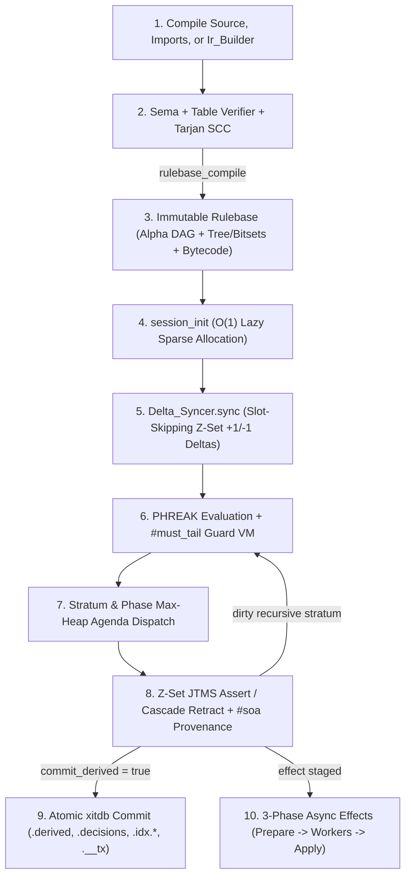

[README](../README.md) · **Docs Hub** · [Odin API](odin-api.md) · [DSL Reference](dsl-reference.md) · [C99 ABI](c-api.md) · [Editors & LSP](editors.md) · [Benchmarks](benchmarks.md) · [Agent Rules](../usage-rules.md)

# Forseti Documentation Hub

Welcome to the **Forseti** documentation hub. This guide helps you pick the right document, learn Forseti's core vocabulary, understand the execution lifecycle, and jump straight into runnable examples.

---

## Choose Your Path

| If you are... | Start Here | What You Will Learn |
| :--- | :--- | :--- |
| **New to rules engines** | [**Rules Engine Primer (`README.md`)**](../README.md#what-is-a-rules-engineand-why-use-one) | Why declarative rules replace fragile `if`/`else` chains, plus the 60-second Quick Start |
| **Writing `.forseti` policies** | [**DSL & CLI Reference (`dsl-reference.md`)**](dsl-reference.md) | Complete EBNF grammar, built-ins, hit policies (`F`/`U`/`A`/`P`/`C*`/`M`/`R`), `E*`/`W*` catalog, CLI |
| **Embedding Forseti in Odin** | [**Odin API Guide (`odin-api.md`)**](odin-api.md) | Lifetimes, `Rulebase` vs `Session`, `typed_api`, `Delta_Syncer`, `explain`/semirings, async effects, AOT |
| **Scaling across threads & tenants (`actors/`)** | [**Sleipnir Actor Runtime (`odin-api.md#11`)**](odin-api.md#11-multi-threaded-actor-runtime-actors--sleipnir) | `Session_Actor`, `Xitdb_Commit_Actor`, `Tenant_Rule_Runtime`, `Parallel_Diff_Replay`, hot-reload |
| **Embedding from C, Rust, Python, Elixir, or Go** | [**C99 ABI Guide (`c-api.md`)**](c-api.md) | Building `libforseti`, [`include/forseti.h`](../include/forseti.h), string/handle ownership, JSON & store API |
| **Setting up IDE / editor tooling** | [**Editors, Formatter & LSP (`editors.md`)**](editors.md) | `forseti fmt`, `forseti lsp`, TextMate & Tree-sitter grammars for Neovim, VS Code, Zed |
| **Evaluating performance & scale** | [**Benchmarks & Scaling (`benchmarks.md`)**](benchmarks.md) | `10`–`1,000,000` rule latency/RAM scaling, hardware PMU counters, `@zero_alloc` hot paths |
| **Integrating as an AI coding agent** | [**Agent Usage Rules (`usage-rules.md`)**](../usage-rules.md) | Prescriptive decision trees, copy-paste recipes, top 16 pitfalls, and 4-layer ATDD rules |
| **Contributing to Forseti** | [**Repository Guide (`AGENTS.md`)**](../AGENTS.md) | Package invariants, canonical check/test/ASan commands, and [`conductor/tracks.md`](../conductor/tracks.md) |

---

## Core Vocabulary & Glossary

| Term | Meaning in Forseti |
| :--- | :--- |
| **Fact** | A typed record stored in working memory (identified by a `Fact_Id` and `(binding, key)`). |
| **Schema & Binding (`source` / `derived`)** | `schema` declares typed fields; `source` and `derived` bind a named working-memory collection to an `xitdb` selector path (e.g., `.accounts.raw[?id]`). |
| **Decision Table & Hit Policy** | A tabular condition-to-output matrix (`table ... hit First \| Unique \| Any \| Priority \| Collect* \| Merge \| Reverse_Merge`) statically checked for completeness, overlaps, and dead rows. |
| **Rule (`when` / `then`)** | An incremental forward-chaining clause block matching patterns, joins, negation (`not`/`exists`), accumulators, or `decide` calls and producing `assert`, `assert!`, `retract`, or `effect` actions. |
| **Phase & Salience** | Agenda scheduling controls: `phase "name"` orders rule stages explicitly, and `salience N` breaks ties (higher priority fires first). |
| **Stratum** | Dependency level computed by Tarjan SCC stratification so recursion stays positive and every `not` or accumulator evaluates strictly after its upstream stratum stabilizes. |
| **Z-Set JTMS (`assert` vs `assert!`)** | Justification-based Truth Maintenance: `assert` tracks logical support (`Fact_Origin.Logical`) and retracts downstream facts automatically when premises vanish; `assert! ... unconditional` writes permanent audit facts. |
| **Provenance Semiring** | Algebraic audit evaluation over a fact's `#soa` derivation DAG: `.Boolean` (exists), `.Why` (minimal witness sets), `.How` (symbolic `AND`/`OR` formula), and `.Viterbi` (minimum-height proof path). |
| **`Core_Overlay` `diff_replay`** | Zero-copy copy-on-write snapshot fork in `xitdb` used to compare baseline vs candidate rulebases without mutating the parent database. |

---

## End-to-End Execution Lifecycle

---

## Core Mental Models

### 1. Three Authoring Tiers over One Canonical `Rulebase_IR`
Every path lowers into the exact same validated `Rulebase_IR` (`forseti/ir.odin`):
- **Tier 1 (External `.forseti`):** Textual policies parsed via zero-copy lexer + Pratt parser (`compile_source`, `compile_file`, `compile_source_with_imports`), hot-reloadable and statically checked with `file:line:col` diagnostics.
- **Tier 2 (Internal Odin DSL):** Typed `Ir_Builder` combinators (`forseti/dsl_odin.odin`) that emit `Rulebase_IR` directly inside Odin code without text parsing.
- **Tier 3 (AOT Odin Codegen):** `codegen_odin_module` / `forseti gen` compiles decision tables directly to standalone `"contextless"` Odin procedures with `0` runtime dependencies or heap allocations.

### 2. Immutable `Rulebase` vs. Pinned `Session`
- **`Rulebase`** is compiled once (`rulebase_compile`), packs all rules, alpha nodes, segments, decision tables, and interned bytecode programs into a compact `vmem.Arena`, and is read-only and shareable across threads during inference.
- **`Session`** (`forseti/session.odin`) holds mutable working memory, lazy `Alpha_Memory` / `Segment_Memory` / `Beta_Memory` tables, the `Agenda`, Z-set JTMS justifications, and `#soa[dynamic]Derivation` provenance records. `Session` and `Store_Bridge` contain internal self-pointers and arenas: **always initialize in-place or heap-allocate with `new(...)` and never copy by value**.

### 3. Logical (`assert`) vs. Unconditional (`assert!`) Truth Maintenance
- **`assert Foo(...)`:** Recorded as a logically justified derivation (`Fact_Origin.Logical`) inside the Z-set JTMS. When any supporting premise retracts or becomes blocked by `not`, Forseti automatically cascades retractions downstream—unless another independent justification keeps the fact supported (diamond support).
- **`assert! Audit(...) unconditional`:** Permanently asserted (`Fact_Origin.Unconditional`) even if all triggering premises are later retracted, making it ideal for compliance audit trails.

### 4. Causal Provenance, Algebraic Semirings & Counterfactual `diff_replay`
In default `.Audit_Full` mode, every rule firing appends a compact 32-byte `Derivation` record into `#soa[dynamic]Derivation` with **zero hot-path SHA-1/SHA-256 hashing**:
- **`explain`:** Walks derivations backward to build a minimal acyclic proof tree (safe even when rules contain cyclic recursion).
- **`impact`:** Computes direct and transitive facts/derivations produced by a specific rule or version.
- **`evaluate_semiring`:** Evaluates provenance algebraically across `.Boolean` (exists), `.Why` (minimal witness fact sets), `.How` (symbolic `AND`/`OR` derivation formula), and `.Viterbi` (shortest/highest-confidence proof path).
- **`session_diff_replay` / `diff_replay`:** Forks a frozen snapshot of `Store_Bridge` using `xitdb.Core_Overlay` (`O(1)` fork cost, `0` mutations to the parent store) and reports exact `added`, `removed`, and `unchanged_count` derived facts for candidate rule changes.

---

## Verified Runnable Examples

All `8` examples in [`examples/`](../examples/) are compiled and leak-checked on CI by [`tests/test_examples_verify.odin`](../tests/test_examples_verify.odin):

1. [`01_decision_tables`](../examples/01_decision_tables/main.odin) — `First` lazy cost skipping (`cost 100`), `Collect_Sum`, `Merge`, and AOT codegen
2. [`02_mdm_xitdb_pipeline`](../examples/02_mdm_xitdb_pipeline/main.odin) — persisted `xitdb` v2 `.xit` pipeline, `Delta_Syncer`, and `.decisions` / `.idx.*` / `.__tx` verification
3. [`03_jtms_steward_overrides`](../examples/03_jtms_steward_overrides/main.odin) — Diamond support survival, cascading retractions, and `assert!` unconditional audit retention
4. [`04_cyclic_hierarchies`](../examples/04_cyclic_hierarchies/main.odin) — Tarjan SCC semi-naive recursion on a 3-node cycle, `explain`, and cycle-break retraction
5. [`05_accumulators_and_effects`](../examples/05_accumulators_and_effects/main.odin) — Tied-minimum retractable accumulators (`count`, `sum`, `min`, `max`) & 3-phase `core:thread` async effects
6. [`06_internal_odin_dsl_and_aot`](../examples/06_internal_odin_dsl_and_aot/main.odin) — Tier 2 `Ir_Builder` internal Odin DSL and Tier 3 AOT Odin code generation
7. [`07_telemetry_and_diff_replay`](../examples/07_telemetry_and_diff_replay/main.odin) — `Telemetry_Sink` (`JSONL` + Chrome Trace), `Core_Overlay` `diff_replay`, and Mermaid graph export
8. [`08_sleipnir_actor_runtime`](../examples/08_sleipnir_actor_runtime/main.odin) — Sleipnir `Session_Actor`, `Xitdb_Commit_Actor`, `Partitioned_Supervisor`, `Rulebase_Coordinator` hot-reload, and parallel `Core_Overlay` `diff_replay`
